# ConvNeXt for Alzheimer's Disease Classification on ADNI (s4884610)

The aim of this report is to classify 2D brain MRI slices from the ADNI dataset [2] as Alzheimer's disease (AD) or
cognitively normal (NC) using a ConvNeXt [1]. This model is trained and built from scratch and is compared against a 
simple CNN baseline model. This report aims to answer one question: under the *Confidence and Ambiguity* dilemma, can the
model tell when it should hand a scan to a human?

Headline result: Both models were able to reach 0.73-0.74 slice-level test accuracy (AUROC ~
0.80), which is below the expected target of 0.8. Although not reaching the required accuracy, analysis showed that
the provided test set contained a mix of both seen and unseen subjects. As a direct result of this the models achieved
0.91-0.96 on seen subjects and 0.40-0.50 on unseen patients. The cause of this is a confound in the training data in which
every training AD scan was acquired in 2011-2013 with older MRI protocols, while every training NC scan was taken in 2017-2021 with newer accelerated protocols. As such both models learn the shortcut of "new protocol -> NC", meaning that come test time, the four trained models got 95-99% of old-protocol AD scans right, but only 15-36% of new-protocol AD scans.


## Contents

1. [Problem and algorithm](#1-problem-and-algorithm)
2. [Feasibility review](#2-feasibility-report)
3. [Dependencies and reproducibility](#3-dependencies-and-reproducibility)
4. [Data, preprocessing and splits](#4-data-preprocessing-and-splits)
5. [Usage](#5-usage)
6. [Experiments](#6-experiments)
7. [Results: ConvNeXt vs baseline](#7-results-convnext-vs-baseline)
8. [Why accuracy plateaus at ~0.73: leakage and a shortcut](#8-why-accuracy-plateaus-at-073-leakage-and-an-associated-shortcut)
9. [Confidence and ambiguity](#9-confidence-and-ambiguity)
10. [Failure case autopsy](#10-failure-case-autopsy)
11. [Recommendation to the project manager](#11-recommendation-to-the-project-manager)
12. [Limitations and future work](#12-limitations-and-future-work)
13. [Artificial Intelligence Usage Disclosure](#13-artificial-intelligence-usage-disclosure)
14. [References](#14-references)

---

## 1. Problem and algorithm

### The problem

Alzheimer's disease causes progressive, irreversible loss of brain tissue, which is visible on T1-weighted structural MRI scans. As such an automated classifier is proposed to
help clinicians screen scans provided that the model is reliable on new patients and can refer patients if it is unsure. This task itself is a binary classification problem in which 
given an MRI slice a prediction of AD or NC must be made. This is a significant challenge as there is natural variation in head shape, age and scanner between patients. In addition to this
for the classification each patient may contribute many MRI slices and as such it is easy to leak patient information between splits.


### How ConvNeXt works

ConvNeXt [1] is a pure convolutional network that takes the same optimisation ideas that have made Vision Transformers so successful. A standard ConvNeXt model contains the following elements:

- Patchify stem: a 4x4 convolution with stride 4 turns the image into a grid of patches.
- Four stages at decreasing resolution and increasing width, with a 2x2 stride-2 convolution between stages to downsample.
- ConvNeXt block: a large 7x7 depthwise convolution which mixes information spatially, one channel at a time, then LayerNorm, then an inverted bottleneck MLP (Linear C->4C, GELU, Linear 4C->C) that mixes channels. The output is then scaled by a learnable LayerScale and finally added back to the input through a residual connection.
- Stochastic depth (drop path): during training, each block's output is randomly dropped for some images, with the drop rate rising linearly from 0 in the first block to the maximum in the last. This is used to regularise the deep stack [6].
- Head: global average pooling, LayerNorm, and a linear layer giving 2 logits.

My implementation (`modules.py`) follows the same general structure as a standard ConvNeXt, however it uses half the width of features (48-96-192-384 instead of 96-192-384-768). As a result of this my model contains 4.83M parameters instead of 28M. This was done to suit the task at hand as we are only dealing with a dataset of ~500 training subjects and an input of 1 channel (greyscale).


<p align="center">
  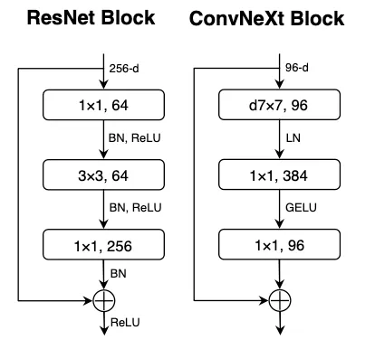
</p>

The ResNet bottleneck block vs ConvNeXt block (Figure 4 from Liu et al. (2022) via KUNGFU.AI [9]) highlights the inverse bottleneck used which shows the ConvNeXt-T widths (96 -> 384 -> 96). Conversely, my model uses half the widths (48, 96, 192, 384) in the four stages, each of which is expanded 4x in the middle of the block. However, this image itself doesn't highlight the LayerScale and drop-path steps applied just before the residual addition.

My network uses the following full structure: 
stem (4x4 conv, stride 4, LayerNorm) -> 

stage 1 (2 blocks, 48 ch) ->
downsample -> stage 2 (2 blocks, 96 ch) ->
downsample -> stage 3 (6 blocks, 192 ch) -> 
downsample -> stage 4 (2 blocks, 384 ch) ->
global average pool -> LayerNorm -> linear (2 classes).

Note: Each downsample is LayerNorm with a 2x2 conv with stride 2, halving the resolution from 60x64 to 7x8.

### Baseline

`BaselineCNN` is a deliberately simple 4-layer CNN: four 3x3 conv -> BatchNorm [8] -> ReLU -> 2x2 max-pool blocks (32, 64, 128, 256 channels), global average pooling and two linear layers (421,954 parameters, which is 11x smaller than the ConvNeXt).

---

## 2. Feasibility Report:

(Note: the leakage check described below was found to be incorrect as the splits
are by scan ID, not patient ID. As such section 4 highlights the subject check that was used in place of this.)


## User Need, Scope & Acceptance Criteria: 

**Intended User:** The primary user is a clinical reviewer who is screening T1-weighted structural brain MRI data.  
**Purpose:** Acts as an assistant that can classify clear cases of AD and report low-confidence results to a specialist for expert examination.  
**Testable acceptance criteria:** Achieve accuracy of at least 0.8 on a held-out test split; must beat baseline in macro-F1 and AUROC score as well.   
**Leakage:** Must check to ensure no patient ID appears in more than one split.  
**Resources:** Train locally with testing; final testing is performed on Rangpur with less than 10GB VRAM and less than 4 hours train time per run.    
**Confidence:** Have a threshold where, if above 90% confidence, accept the result automatically, whilst ensuring that no more than 30% of the scans themselves are referred to an expert.

## Model Choice & Course Concepts:

**Dataset:** ADNI at /home/groups/comp3710/ADNI. Has two classes: AD and CN. Splits are made by the patient ID. Ensuring no leakage by the checks described above.  
**Baseline:** simple small CNN with 3-4 convolution blocks with the same test splits and preprocessing.   
**Model:** ConvNeXt: [https\://www\.geeksforgeeks.org/computer-vision/convnext/](https://www.geeksforgeeks.org/computer-vision/convnext/)  
**Related Course concepts:** CNNs, activation functions, normalisation, regularisation.   
**Confident analysis:** softmax confidence, reliability diagrams, with temperature scale fitting on the validation set as a fix for uncertainty. 

## Preliminary Feasibility Evidence: 

20 steps of the implemented torch cnn took 0.132 secs per stage, with 4.7 gb total vram. At batch size of 32, it is approximately 40 seconds of compute time for 10,000 training images. With both the training for AD and NC 20,000 training images should take approximately 80 seconds per epoch, or 50 epochs per hour. Which is well within the bounds set above.  
The following test/train split was found in the data: AD\_NC/test/NC **4540**, AD\_NC/test/AD **4460**, AD\_NC/train/NC **11120**, AD\_NC/train/AD **10400\.**  
Image size from testing is 256x240(W, H) and is a grayscale image.  
No overlap between patient id’s is confirmed from initial testing.

## Risks, Budget & Fallback:

**Rangpur queue delays:** run models locally as I have access to a 16GB VRAM GPU locally.  
**Patient leakage:** testing on Rangpur confirms that there is no overlap between train and test splits.  
**Overconfident wrong predictions:** temperature scaling to adjust confidence score while keeping the accuracy and classification itself the same.  
**Next experiment:** train the baseline CNN to convergence and a smaller version of the ConvNeXt and plot the reliability diagram of each.   
**Fallback:** Run the ConvNeXt with fewer blocks, narrower stages and reduced input resolution. The pipeline itself is the same so we ensure there is always something runnable if we simplify the model but keep the same structure.   
**Budget:** From before, 50 epochs per hour for the ConvNeXt with only 4.7GB VRAM; call it 10 runs total, 50-100 epochs per test; that gives around 10 to 20 GPU hours total.

---

## 3. Dependencies and reproducibility

| Package | Version |
|---|---|
| Python | 3.12.0 |
| PyTorch | 2.11.0 (+cu128) |
| torchvision | 0.26.0 |
| scikit-learn | 1.9.1 |
| matplotlib | 3.11.2 |
| Pillow | 12.3.0 |
| NumPy | 2.5.2 (only in `predict.py`; `modules.py` uses PyTorch only) |

```bash
pip install torch torchvision --index-url https://download.pytorch.org/whl/cu128
pip install scikit-learn matplotlib pillow
```

Hardware: all reported runs were trained on an NVIDIA RTX 3060 (12 GB, driver 617.14) under
Windows 11. `train.sh` is a Slurm script for the same training on Rangpur.

Reproducibility:
- The train/val split is deterministic (`seed=42`, stratified by label, at subject level).
- Every run saves its full configuration and per-epoch history to `<out_dir>/<model>_results.json`.
- All flags default to the original settings, so earlier runs can be rerun with identical settings.
- Weight initialisation and data-loader shuffling are not seeded, so retraining gives slightly
  different numbers.

---

## 4. Data, preprocessing and splits

### Data

The course copy of ADNI (`/home/groups/comp3710/ADNI/AD_NC`) contains 256 x 240 greyscale JPEG
slices, already skull-stripped, 20 slices per scan:

| Split | AD | NC | Scans | Subjects |
|---|---|---|---|---|
| train (official) | 10,400 | 11,120 | 1,076 | 565 |
| test (official) | 4,460 | 4,540 | 450 | 331 |

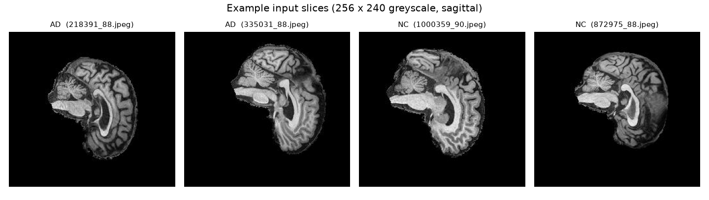

### Subject-level splitting (leakage prevention)

The file names present in the provided dataset are in the form of `<id>_<slice>.jpeg`. During the feasibility report I first assumed that `<id>` was a patient ID. Later analysis highlighted that it was instead a scan ID, which means that one subject can have multiple scans from different visits. Thus my initial approach of splitting by scan ID would place the same person's slices in both the train and validation sets. To resolve this, `meta_data_with_label.json` was used as it provides a `raw` path which contains the individual ADNI subject IDs. Using this `dataset.py` was made to instead map every scan to its subject. This was confirmed with `analysis.py` with all 1,526 scans matched. Using this the following was done and highlighted:

- The official train folder is split into train (480 subjects, 85%) and validation (85 subjects,
  15%) by subject, stratified by label (`split_by_patient`)
- Assertions were made so that no subject is in both train and validation
- Indicator of how many test subjects appear in both the train and validation sets.

This final step revealed that 216 of the 331 official test subjects also appear in the official training set. This was a significant finding as it is not a clean held-out set, the effects of which are highlighted in section 8. This was not resolved so that my results from these models are comparable with other results. This leakage found is significant as it inflates many reported AD classification results [5], and as such the test results were reported separately for seen subjects (278 scans) and unseen subjects (172 scans).


### Preprocessing and augmentation

- Per-image standardisation (zero mean, unit variance for each slice) to remove brightness
  differences between scans.
- Training augmentation (default): random horizontal flip, ±10° rotation, ±5% shift, ±5% zoom.
- Strong augmentation (`--strong_aug`, final runs): ±15° rotation, ±10% shift, ±10% zoom, brightness/contrast jitter (±20%), and random erasing of a small patch (p = 0.25). The aim of this was to stop the model recognising individual subjects by head shape, position or intensity.
- Validation and test images are only standardised, never augmented.

---

## 5. Usage

### Training

```bash
# Final ConvNeXt (run 3)
python train.py --model convnext --epochs 50 --schedule cosine --weight_decay 0.05 \
    --label_smoothing 0.1 --drop_path 0.1 --strong_aug \
    --data_root <path>/AD_NC --out_dir outputs_pc_reg

# Baseline with the arguments
python train.py --model baseline --epochs 50 --schedule cosine --weight_decay 0.05 \
    --label_smoothing 0.1 --strong_aug --data_root <path>/AD_NC --out_dir outputs_pc_baseline_bn

# On Rangpur
sbatch train.sh convnext 50 1e-3
```

| Flag | Default | Meaning |
|---|---|---|
| `--model` | `baseline` | `baseline` or `convnext` |
| `--epochs`, `--batch_size`, `--lr` | 20, 32, 1e-3 | |
| `--weight_decay` | 0.01 | AdamW weight decay |
| `--schedule` | `constant` | `constant` or `cosine` (learning rate -> 0 over training) |
| `--label_smoothing` | 0.0 | e.g. 0.1 -> targets become 0.95 / 0.05 [7] |
| `--drop_path` | 0.0 | maximum stochastic-depth rate (ConvNeXt only) |
| `--strong_aug` | off | stronger training augmentation |

Outputs: `<model>_best.pt` (best validation accuracy), `<model>_curves.png`, `<model>_results.json`.

### Evaluation

```bash
# Full evaluation: metrics, resources, calibration, reject option, failure cases
python predict.py --model convnext --out_dir outputs_pc_reg --data_root <path>/AD_NC

# Single slice
python predict.py --model convnext --out_dir outputs_pc_reg --image <path>/AD_NC/test/AD/1175356_103.jpeg

# Seen/unseen, scan-level, test-time augmentation, ensemble and confound analysis, analysis figures (each --run is <model>:<out_dir>:<label>)
python analysis.py --data_root <path>/AD_NC \
    --run "baseline:outputs_pc_baseline_bn:Baseline CNN" \
    --run "convnext:outputs_pc:ConvNeXt run 1" \
    --run "convnext:outputs_pc_cosine:ConvNeXt run 2" \
    --run "convnext:outputs_pc_reg:ConvNeXt run 3" \
    --curve outputs_pc/baseline_curves.png:baseline_nobn_curves.png \
    --curve outputs_pc_baseline_bn/baseline_curves.png:baseline_curves.png \
    --curve outputs_pc/convnext_curves.png:convnext_run1_curves.png \
    --curve outputs_pc_cosine/convnext_curves.png:convnext_run2_curves.png \
    --curve outputs_pc_reg/convnext_curves.png:convnext_run3_curves.png \
    --out outputs_pc_reg/analysis.json

# Redraw the figures from the saved JSON without re-running the models
python analysis.py --data_root <path>/AD_NC --out outputs_pc_reg/analysis.json --figures_only
```

Run `predict.py` before `analysis.py`: the analysis from `analysis.py` looks up the failure cases that `predict.py`
saves. Figures come from three places: `predict.py` (confusion/ROC, reliability, referral, failures),
`analysis.py` (example slices, seen vs unseen, accuracy by era, copied training curves), and the ConvNeXt block diagram from [1].


Example single-slice output (temperature-scaled confidence, accept threshold 0.9):

```
.../test/NC/1182968_109.jpeg: NC (confidence 0.974) -> ACCEPT
.../test/AD/1175356_103.jpeg: NC (confidence 0.979) -> ACCEPT
```

`predict.py` writes figures to `images/` and numbers to `<out_dir>/<model>_eval.json`.

---

## 6. Experiments

Every experiment uses the same subject-level splits. In total there were 5 training runs and a set of additional experiments on the saved checkpoints from the models. Each experiment aimed to test a specific hypothesis:


| # | Strategy | What was attempted | Hypothesis | Outcome |
|---|---|---|---|---|
| 1 | Baseline sanity | 4-layer CNN, no normalisation, 30 epochs | simple CNN as reference | Collapsed: always predicts NC (test 0.504) |
| 2 | Diagnosis | overfit one batch; measure ReLU activity | pipeline bug vs optimisation problem | could overfit one batch (94%), so data is fine; 85-95% of ReLUs in conv2-4 died during training -> added BatchNorm |
| 3 | Architecture | ConvNeXt, constant lr, 30 epochs | modern CNN reaches >= 0.8 | val 0.856, test 0.737 |
| 4 | Optimisation | cosine schedule, weight decay 0.05, 50 epochs | val still rising, so train longer | val 0.888 but test 0.726, test loss 0.80 -> 1.18: more memorisation |
| 5 | Regularisation | + label smoothing 0.1, drop path 0.1, strong augmentation | stop the model memorising subjects | test 0.732, unseen-subject acc 0.40 -> 0.47, test loss 1.18 -> 0.70 |
| 6 | Architecture comparison | fixed baseline (BatchNorm), same arguments as #5 | is ConvNeXt the bottleneck? | test 0.737: same ceiling with an 11x smaller model |
| 7 | Inference aggregation | average the 20 slices of each scan | scan-level decisions are more stable | +0.5 to +1.7 points over slice accuracy (best 0.753) |
| 8 | Test-time augmentation | average with the mirrored slice | reduce variance | -0.2 to +0.6 points |
| 9 | Ensembling | average all four models | models make different errors | test slice 0.748, scan 0.747 |
| 10 | Decision threshold | AD threshold chosen on validation | model is biased towards NC | thresholds of 0.47-0.56 chosen; no consistent gain (-0.5 to +1.3 points of scan accuracy) |
| 11 | Calibration | temperature scaling fitted on validation | fixes overconfidence | made test calibration worse (Section 9) |
| 12 | Error analysis | seen vs unseen subjects, class balance, scanner sites, acquisition dates and MRI sequences | why is every run limited at accuracy of 0.73? | found the acquisition-protocol confound (Section 8) |

### Training curves

| Baseline without BatchNorm (collapsed) | Baseline with BatchNorm (final) |
|---|---|
| 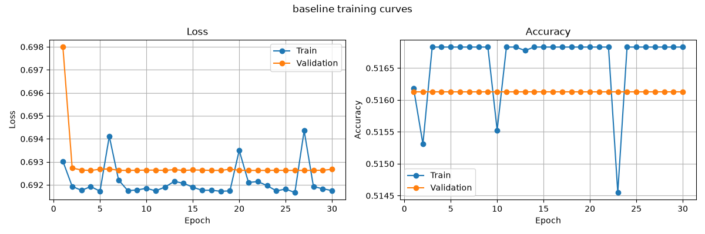 | 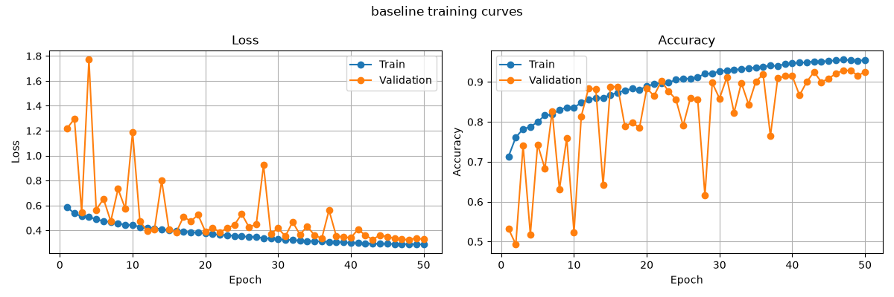 |

As highlighted above, the two baseline plots show that without BatchNorm, the loss remains at approximately 0.69 and the validation accuracy of the model remains at approximately 0.516 for every epoch. This demonstrates that the model always predicts the class with the higher share for every single input. Conversely, with BatchNorm, it begins learning quickly with 0.71 train accuracy after only one epoch. The model's validation accuracy does not grow as quickly and appears to jump between approximately 0.49 and 0.9 during the first 25 epochs due to the higher learning rate. This, however, stabilises to 0.87 to 0.93 in the last 10 epochs as the cosine schedule lowers the learning rate toward the end. 

| ConvNeXt run 1 (constant lr) | ConvNeXt run 2 (cosine + weight decay) |
|---|---|
| 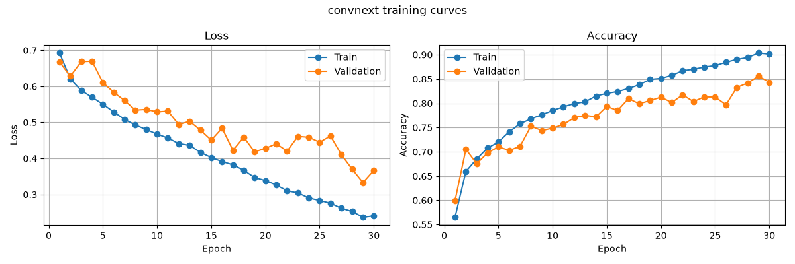 | 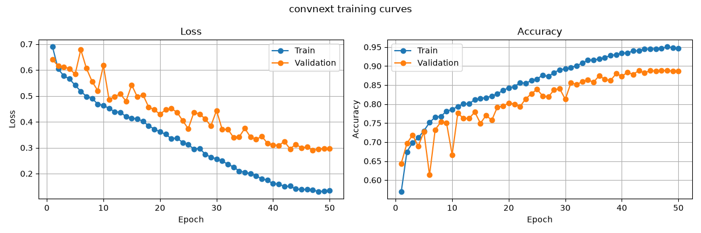 |

The figures above highlight that for both ConvNeXt runs, the train and the validation steadily rise together, with the validation itself still rising in the later epochs. From this we may conclude that run 2 is the better model as it reaches a higher validation accuracy (0.888 vs 0.856) and a lower final validation loss (0.30 vs 0.37), however, the test results indicate otherwise. On the test run itself, the accuracy falls slightly from 0.737 to 0.726, and the test loss rises dramatically from 0.8 to 1.18. This concludes that the extra epochs that made the model more confident in the cases it got correct also made it more confident in the cases where it was wrong (Section 9).

ConvNeXt run 3 (final: cosine + weight decay + label smoothing + drop path + strong augmentation)

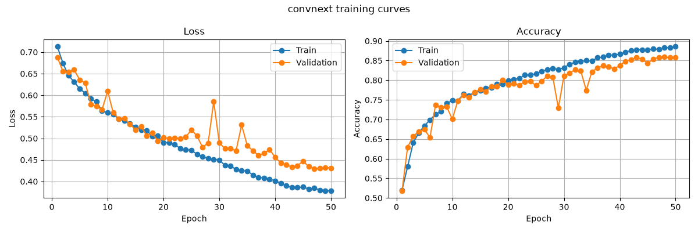

The figure above highlights that run 3 rises more slowly and finishes with a train accuracy of 0.886 compared to run 2 of 0.946. From this it is clear that the gap between the train and validation is half of that between runs 1 and 2 (0.028 vs 0.058-0.059). This suggests that the regularisation implemented made the model less able to just memorise the training subjects and as such the gap between the train and validation is much lower. As a result of this we find that the test loss from doing so comes down to 0.7. 

An interesting finding that all the curves have in common is that none of them provide any indication of the performance in the test set. In every run performed, the best validation checkpoint is from one of the last epochs, while the test accuracy is flat at 0.73 to 0.74. This is interesting as the gap between the validation and test grows as the validation of each model increases. This must indicate that rather than overfitting itself, the validation and the test sets must be measuring/recording different things. This is highlighted in section 8, which shows that there is a confound between the two sets and as such checkpoint selection or early stopping on this validation set cannot prevent the model from failing on the test set.

---

## 7. Results: ConvNeXt vs baseline

Final models: ConvNeXt run 3 and the BatchNorm baseline, trained with the same arguments on
the same splits. These results are from the same test set using the same threshold of 0.5:

| Metric | Baseline CNN | ConvNeXt | Better |
|---|---|---|---|
| Accuracy | 0.737 | 0.732 | ~ |
| Precision (AD) | 0.867 | 0.819 | baseline |
| Recall (AD), i.e. sensitivity | 0.555 | 0.590 | ConvNeXt |
| Recall (NC), i.e. specificity | 0.917 | 0.872 | baseline |
| Macro-F1 | 0.728 | 0.726 | ~ |
| AUROC | 0.801 | 0.805 | ~ |
| Scan-level accuracy | 0.742 | 0.749 | ~ |
| Scan accuracy, seen subjects | 0.957 | 0.921 | baseline |
| Scan accuracy, unseen subjects | 0.395 | 0.471 | ConvNeXt |
| Test loss (cross-entropy) | 0.80 | 0.70 | ConvNeXt |
| Best validation accuracy | 0.929 | 0.859 | (misleading, see Section 8) |

| Baseline | ConvNeXt |
|---|---|
|  | 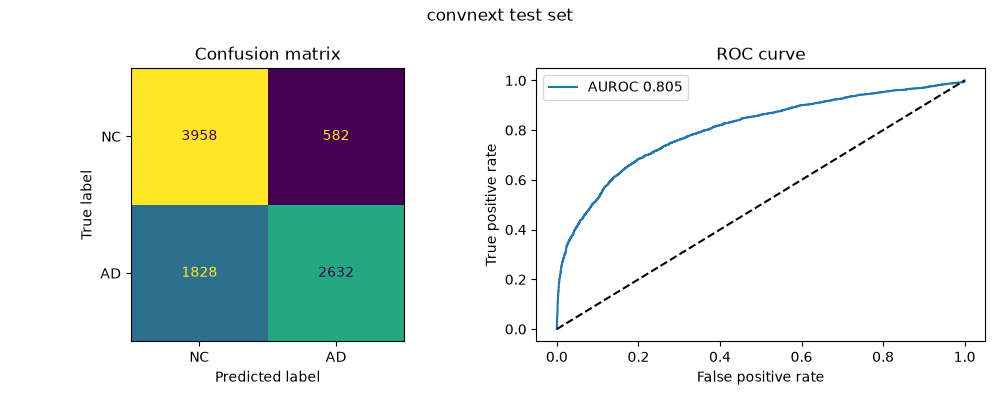 |

The table and confusion matrices highlight that both models' biggest source of error is from the missed AD. Specifically, the baseline labels 1,985 of the 4,460 AD slices as NC (44.5%), and ConvNeXt 1,828 (41.0%). Conversely, the false alarm rate is much lower with 379 of 4,540 NC slices (8.3%) for the baseline, and 582 (12.8%) for ConvNeXt. This indicates that ConvNeXt trades approximately 200 additional false alarms for 160 fewer missed AD slices. This is a significant finding as in screening, a missed AD case is a far more concerning error compared to a false alarm, and as such ConvNeXt is preferred despite a similar accuracy compared to the baseline. 

The ROC curves between both models are almost identical with AUROC scores of 0.801 and 0.805 which indicates that both models are equal in their ability to rank AD above NC. This in conjunction with the confusion matrices highlights that ConvNeXt's scores lean more towards AD, so at 0.5 threshold it labels more slices AD, which in turn catches more AD cases but also raises more false alarms as discussed. For both models the AUROC scores highlight that the scores are far from random and section 8 itself highlights why this is the case. 

The remaining metrics from the table continue to add to this picture. The baseline model features a higher AD precision (0.867 vs 0.819), however, because it predicts AD less often, the slices it does
label AD are more likely to be correct, but it misses more AD cases overall. Furthermore, averaging the results from the 20 slices of each scan only marginally raises the accuracy of both models (baseline 0.737 to 0.742, ConvNeXt 0.732 to 0.749). This indicates that most of the errors made are not from random mistakes on the individual slices, but affect the entire scans and subjects together. The largest difference between the two models is on subjects seen
in training versus unseen subjects. The baseline is better on seen subjects (0.957 vs 0.921) but is worse on unseen ones (0.395 vs 0.471), which suggests it relies more on recognising subjects it
has already seen. However, both models' accuracy on unseen subjects is worse than guessing randomly, which section 8 highlights. Finally, the baseline model has a higher validation accuracy, but does not produce better test accuracy; this suggests that for both models, the validation accuracy is not a reliable indicator of success in the test set.


In terms of meeting the acceptance criteria highlighted in the brief and feasibility review, there are significant shortcomings. The accuracy requirement of 0.8 or greater is not met by either model so it fails here. Additionally, the feasibility report requires that the ConvNeXt must beat the baseline in macro-F1 and AUROC. However, because the differences are -0.002 for F1 and +0.004 for AUROC, there is not enough of a margin to succeed in this requirement either. 


### Resources

| | Baseline CNN | ConvNeXt |
|---|---|---|
| Parameters | 421,954 | 4,832,018 (11.5x) |
| Training time (50 epochs, RTX 3060) | 67.1 min | 111.1 min |
| Peak training VRAM (batch 32) | 1.31 GB | 1.47 GB |
| Inference latency (1 slice, batch 1)* | 0.79 ms | 3.71 ms |
| Peak inference VRAM (1 slice, batch 1) | 0.025 GB | 0.034 GB |


\*Note: the latency varies between runs with GPU clock speed and background load, so these are approximate values that depend on the setup used. Exact results can be extracted from `<model>_eval.json`.

The resource table highlights that both the models are within the 10 GB VRAM limit and less than 4 hours per run acceptance criteria highlighted in the feasibility report. The resource allocation and the above analysis between the two models poses the following question: Does the additional complexity of ConvNeXt pay off? Results indicate that the gain from more complexity is marginal. We found that ConvNeXt catches more AD (recall 0.59 vs 0.56), generalises marginally better to unseen subjects (0.47 vs 0.40), is better calibrated (test loss 0.70 vs 0.80, ECE 0.130 vs 0.148) and is less often confidently wrong (Section 9). However, it uses 11x the parameters, 1.7x the training time, and 5x the latency. This indicates that in its current state the model is not good enough to employ in a practical setting. 

---

## 8. Why accuracy plateaus at ~0.73: leakage and an associated shortcut


The above analysis highlights that despite four working training runs with 2 different architectures, and four post-training adjustments, the accuracy of each model was bounded from 0.73 to 0.76. As a result of this additional analysis was conducted to determine if there were additional factors at play that were limiting performance in training. Two key findings were found that explained this:

### Finding 1: the test set mixes seen and unseen subjects
As highlighted at the beginning of the report 216 patients were found to be in both the test and the train set. To investigate how impactful this would be, the 450 test scans were split based on whether the patient appeared in either the training or the validation set. 

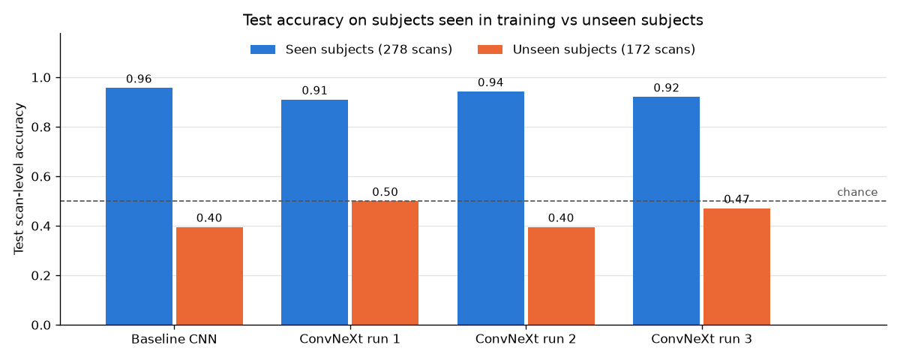

This figure highlights that every model scores between 0.91-0.96 on subjects it has seen, but only 0.40-0.50 on new
subjects. Thus the overall test accuracy computed is the weighted mix of these which gives: 0.62 x ~0.93 + 0.38 x ~0.45 ~ 0.75. Thus changes to training suggest that accuracy is only moved between the two groups. This is highlighted as such:
- Longer training (run 2) improved seen subjects (0.91 -> 0.94) and hurt unseen ones (0.50 -> 0.40).
- Regularisation (run 3) did the reverse (0.92 / 0.47).

In addition to this the seen-subject scores should also not be taken at face value, as they are inflated by leakage, meaning that the model may be recognising the person rather than the disease itself. The unseen-subject scores (0.40-0.50) are therefore a better representation of the performance and accuracy that a new patient would experience. 

### Finding 2: an acquisition-protocol confound in the training data
It was found that the subjects in the validation set are also unseen, and yet they score 0.93-0.98 at scan level. This begs the question of why specifically unseen patients in the test set fail so dramatically. The 172 unseen-test scans are 69% AD, while train and val are close to 50/50, however, almost every error by both models is an AD patient predicted as NC. These findings led me to analyse the `meta_data_with_label.json` which contains its acquisition date and MRI sequence. From this file it was found that all unseen-test sites also appear in training, so the decrease in performance in the test set is not a new-site effect. By grouping the scans by the acquisition date we find that the label can be read off the scan date. Meaning that, you could get every training scan's label right just from the date it was scanned, without looking at the brain at all. 

| Scans | AD acquired <= 2015 | AD acquired >= 2016 | NC acquired <= 2015 | NC acquired >= 2016 |
|---|---|---|---|---|
| Train | 445 | 0 | 0 | 473 |
| Validation | 75 | 0 | 0 | 80 |
| Test, seen subjects | 101 | 3 | 0 | 173 |
| Test, unseen subjects | 2 | 116 | 0 | 53 |

*(5 scans have no parseable date.)*

- Every training AD scan was acquired in 2011-2013, mostly with older sequences (`MPRAGE`,
  `MPRAGE_GRAPPA2`, `MPRAGE_SENSE2`, `Sag_IR-SPGR`).
- Every training NC scan was acquired in 2017-2021, mostly with newer accelerated sequences
  (`Accelerated_Sagittal_MPRAGE`, `Accelerated_Sag_IR-FSPGR`, …).
- Different sequences and scanners can produce images with different contrast and noise. So
  inside the training data, "looks like a new-protocol scan -> NC" is a 100% reliable shortcut.
- The test set does contain new-protocol AD scans (119), a combination never present in
  training, and 116 of them come from unseen subjects.

To test whether this proposed shortcut is the shortcoming of the model, test scan-level accuracy was grouped by class and acquisition era:

| Test scans | Baseline | ConvNeXt run 1 | ConvNeXt run 2 | ConvNeXt run 3 |
|---|---|---|---|---|
| AD, acquired <= 2015 (103 scans) | 0.990 | 0.971 | 0.971 | 0.951 |
| AD, acquired >= 2016 (119 scans) | 0.168 | 0.361 | 0.151 | 0.294 |
| NC, acquired >= 2016 (226 scans) | 0.934 | 0.863 | 0.934 | 0.898 |

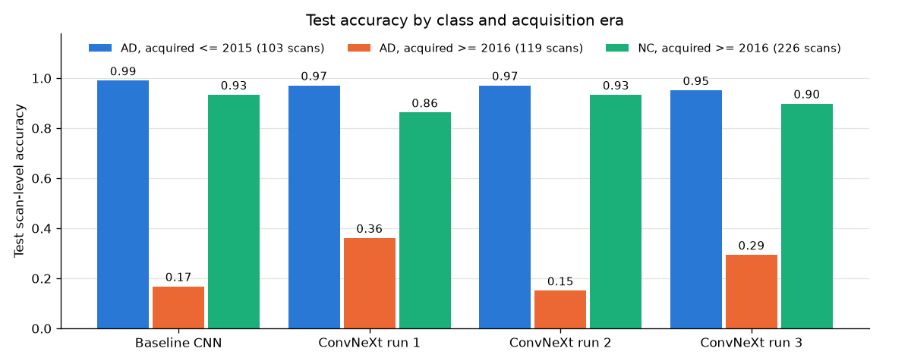

These results highlight that all four models recognise old-protocol AD almost perfectly and miss 64-85% of new-protocol AD. This suggests that they learnt to analyse the protocol used rather than the Alzheimer's anatomy, as we would find that if they had learnt the anatomy, the acquisition date of the scan would not directly impact the models' performance.

These findings explain every observation found throughout this report:

1. Validation looks excellent (0.86-0.93): validation has the same date/label confound, so the shortcut works there.
2. Unseen test subjects are at or below chance: they are mostly new-protocol AD, which the shortcut labels NC.
3. All 9 distinct failure cases from `predict.py` (Section 10) are AD scans acquired in 2018-2021 with accelerated sequences.
4. Two very different architectures hit the same ceiling: neither can learn a combination the data never shows.
5. Augmentation and regularisation helped only slightly: they make it harder to memorise *individuals*, but cannot add the missing new-protocol AD examples.
6. The seen/unseen split in Finding 1 is mostly this confound: the seen-subject AD test scans are 97% old-protocol (101 of 104), while the unseen ones are 97% new-protocol (116 of 119).

These findings highly suggest shortcut learning [4], and it is exactly what the dilemma warns about: *deceptively high aggregate accuracy concealing catastrophic overconfidence on out-of-distribution cases*.
All numbers in this section are produced by `analysis.py`.

---

## 9. Confidence and ambiguity

### Calibration
To determine the confidence of each model, reliability diagrams were made on the test set. In these diagrams the model's confidence (x-axis) is compared with how often it is actually right (y-axis). Bars below the diagonal mean the model is overconfident. 


| Baseline | ConvNeXt |
|---|---|
| 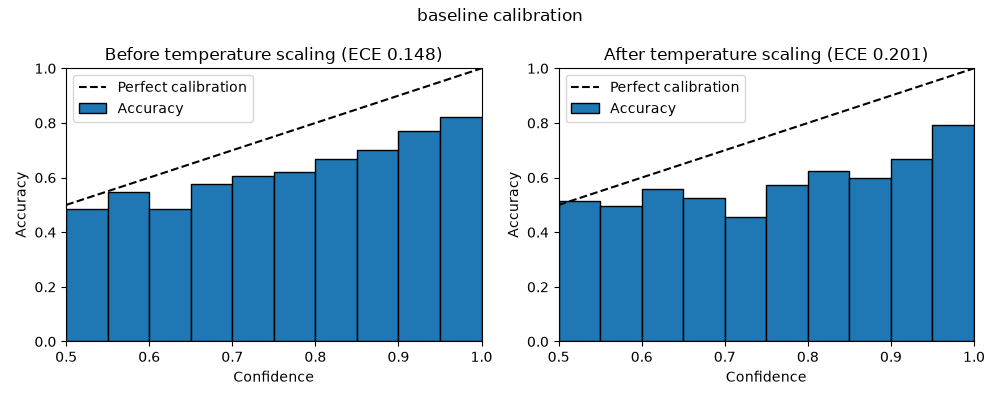 | 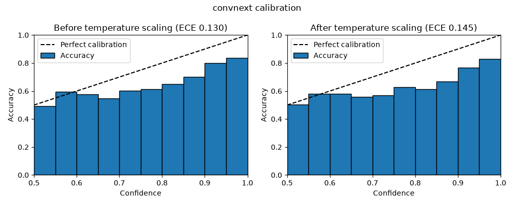 |

| | Baseline | ConvNeXt |
|---|---|---|
| Validation ECE (before scaling) | 0.064 | 0.023 |
| Test ECE before temperature scaling | 0.148 | 0.130 |
| Fitted temperature T (on validation) | 0.60 | 0.90 |
| Test ECE after temperature scaling | 0.201 | 0.145 |
| Wrong test slices with confidence >= 0.9 | 1,619 of 2,364 (68%) | 1,106 of 2,410 (46%) |

*All values in this table are saved by `predict.py` in `<model>_eval.json` (`temperature` and `calibration`).*

Results from the table highlight that on the validation set, both models' confidence matches how often they are correct (ECE 0.064 for the baseline, 0.023 for ConvNeXt). However, on the test set they are overconfident, meaning that they are right less often than their confidence suggests (ECE 0.148 and 0.130). As discussed, the test set contains the new-protocol AD scans, which are unlike anything seen in training, and as a result the models remain just as confident despite getting most of them wrong. 

Additionally, it was found that temperature scaling made test calibration worse. Temperature scaling [3] works by dividing the model's output by a number T which is fitted on the validation set. On validation the models were slightly under-confident, so the fitted values were below 1 (0.60 for the baseline, 0.90 for ConvNeXt) and as such were made *more* confident. This is because for the test set the values were already overconfident and as such temperature scaling increased the ECE (0.148 -> 0.201 and 0.130 -> 0.145). The key finding of this is that calibration fixes, such as temperature scaling, only work if the data it is fitted on resembles the data it will be used on. Because the validation set uses the same discussed shortcut and the test set does not, the scaling only pushed the confidence in the wrong direction. 

Furthermore, we find that ConvNeXt handles uncertainty better than the baseline, but still does not do it well. The table above suggests that fewer of its mistakes are made with at least 90% confidence (1,106 of 2,410, against 1,619 of 2,364 for the baseline). However, approximately half of its mistakes are still confident ones, and 982 of those 1,106 are AD patients predicted as NC, meaning that the diagnosis is missed, which is extremely dangerous in the medical field. 

### Reject option

The feasibility review concluded that for the model to be successful it must automatically accept when confidence was greater than 90%, otherwise the patient must be referred to a clinician, with at most 30% of the patients referred. Thus using the temperature-scaled confidence applied in `predict.py` produces the following:

| Rule | Baseline: referred | Baseline: accuracy of accepted | ConvNeXt: referred | ConvNeXt: accuracy of accepted |
|---|---|---|---|---|
| No rejection | 0% | 0.737 | 0% | 0.732 |
| Confidence >= 0.8 | 11.2% | 0.764 | 20.6% | 0.773 |
| Confidence >= 0.9 (proposed) | 18.7% | 0.779 | 36.7% | 0.806 |
| Confidence >= 0.95 | 26.9% | 0.791 | 60.5% | 0.829 |
| Largest threshold within 30% referral | 0.961 -> 0.796 | | 0.869 -> 0.793 | |

*All values in this table are saved by `predict.py` in `<model>_eval.json` (`reject_table`). The full referral curve is plotted below, with the 0.9 threshold marked.*

| Baseline | ConvNeXt |
|---|---|
| 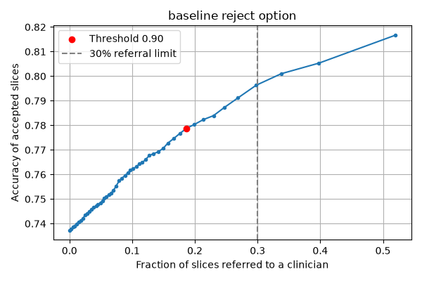 | 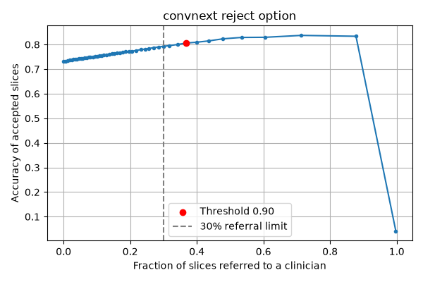 |

This table suggests that neither model meets the safety criteria outlined. Within the highlighted 30% referral rate, we find that the accepted slices are only ~0.79-0.80 accurate. For a 90% confidence it was found that for ConvNeXt, it would require a referral rate of 36.7% which still falls outside of the minimum criteria set. In addition to this the accuracy-vs-referral curves highlight that referring more cases does not improve accuracy significantly. This is because of the analysis described in section 9, with many errors carrying the highest confidence. One interesting finding from the ConvNeXt curve is the sharp drop at the very right. It indicates that the small number of cases where the model was very confident were ones where it was almost entirely wrong. This leads us to the conclusion that a confidence threshold cannot catch a model that is confidently wrong because of a shortcut it learned from the training data, such as calling every new-protocol scan NC.

## 10. Failure case autopsy

`predict.py` shows the five most confident mistakes per model, one per scan:

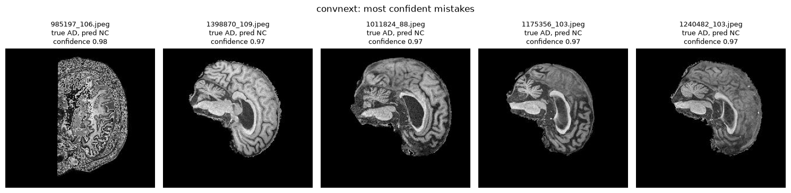
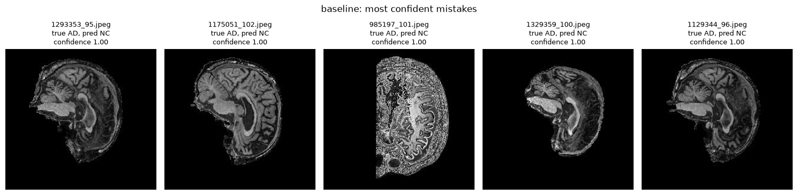

All ten (nine distinct scans) are from when the model predicted AD patients as NC with a confidence of 0.97-0.98 for ConvNeXt and 1.00 for the baseline (before temperature scaling). Every failure case is from an unseen subject (011_S_6303, 057_S_6746, 114_S_6347, 126_S_6683, 129_S_6784, 168_S_6735, 168_S_6828) with an accelerated sequence (`Accelerated_Sagittal_MPRAGE` or `Accelerated_Sag(ittal)_IR-FSPGR`). This aligns with the findings in section 8, as these are exactly the protocols seen only on NC scans in training.


| Case | What is visible | Likely trigger |
|---|---|---|
| `985197_106` / `985197_101` (both models, 0.98 / 1.00) | a slice with very little brain tissue and noisy artefacts | ambiguous input: this slice carries little diagnostic information, however both models are near-certain. Slices that do not provide constructive evidence should be referred and not accepted. |
| `1011824_88`, `1398870_109` (ConvNeXt, 0.97) | middle slices with enlarged ventricles | clear case of shortcut over anatomy: the disease signs are visible, but the model follows the new-protocol shortcut. |
| `1175356_103`, `1240482_103` (ConvNeXt); `1293353_95`, `1329359_100`, `1129344_96` (baseline) | lower grey/white-matter contrast and a darker overall appearance than typical training slices | protocol shift: newer-protocol intensity, which the models have only ever seen paired with NC. |
| Same subject, several scans (`1293353`, `1129344` -> 126_S_6683; `1240482`, `1398870` -> 168_S_6828) | the same subject is misclassified across visits | this is subject-level failure, errors are systematic for a person, and are not random per slice. |

From this there is a common pattern which is the dangerous error type of missed AD. Because the training data never covered AD scanned with newer protocols, the model is often wrong with maximum confidence.

---

## 11. Recommendation to the project manager

It is thus my recommendation to the project manager that neither model be deployed for automated triage. This is because of the following factors:

1. The headline accuracy is misleading: 0.73 overall hides ~0.97 on AD scans from older scanners and only 0.15-0.36 on AD scans from newer protocols.
2. The failure mode is dangerous: On AD patients scanned with newer protocols, the model says "normal" with 97-100% confidence. Those are exactly the false negatives the reject option was supposed to prevent, and it cannot.
3. The proposed 90%-confidence rule fails its own criteria. Within the 30% referral rate accepted cases are only ~80% accurate.
4. ConvNeXt vs baseline: if a model must be chosen, ConvNeXt is the better candidate for triage despite its cost. It has better AD recall, better calibration and fewer confident errors. However, it must be noted that its advantage is small, but the extra complexity is not what limits performance such as in cases with overfitting.
5. The solution is in the data itself, and not the model:
   - Train on AD and NC from every acquisition era and protocol.
   - Evaluate on a test set that is disjoint on patients, and report accuracy per protocol/site before concluding the model is a success and it can be trusted.
   - Check whether any metadata (date, scanner, site) predicts the label.

Until these changes are made, every scan should still be read by a clinician. Although not ready for direct employment for automated triage, the model could be used as a secondary reader which triggers closer looks at scans. 

---

## 12. Limitations and future work

Limitations:
The main limitation of this work is that the official test set shares 216 subjects with the training set, which means that the official test accuracy is optimistic for those subjects already in the set. In addition to this the training data contains no AD scans from 2016 onwards and no NC scans before 2016, which means that the protocol confound cannot be removed by any change to the model or training alone. In terms of the models themselves, as training was done locally, the effects of three separate regularisers could not be found. In future, given a large compute budget, the regularisers should be run separately to see what their individual effects are. With this, each configuration was only trained once with no repeated seeds, meaning that the effect of initial model starting parameters could not be determined.

Future work:
- Re-split all 1,526 scans by subject and stratify by acquisition era x label. The official test set contains 119 new-protocol AD scans that could be partly moved into training, so the shortcut is no longer 100% reliable and the test set is clean.
- Multi-slice (2.5D) or 3D input: because Alzheimer's damage is 3D and not 2D, neighbouring slices could be fed into the model as channels to improve the model's ability to recognise indicators of the disease rather than recognising patients or protocols used. 
- Subject-balanced sampling: ensure that every subject is seen equally often to ensure that the model then learns from a broader mix of people rather than a few frequent ones.
- Pretrained weights, which could help models by giving them a strong starting point to work from.

---

## 13. Artificial Intelligence Usage Disclosure
Tools used: Claude (Anthropic) through Claude Code

What the AI assisted with:
- *Explanations and planning:* explaining ConvNeXt, calibration, temperature scaling, drop path, label smoothing and augmentation, suggesting the order of experiments.
- *Code scaffolding:* drafting parts of `dataset.py`, `modules.py`, `train.py` and `predict.py` as small snippets of skeleton structure to get started, which I reviewed, tested and committed incrementally. 
- *Debugging and analysis:* diagnosing the collapsed baseline (single-batch overfit test, dead-ReLU measurement), running the seen/unseen and site analyses that pointed to the confound, a script run on Rangpur that listed acquisition dates and sequences per class, assited with fixing bugs in the figure generation and improving the generated figures.
- *Environment:* setting up the Windows Python environment and commands to copy the data from Rangpur.
- *Documentation:* drafted a skeleton format for this README, Converted my word document to markdown formatting, assisted with spelling mistakes and grammar, suggestions to improve clarity of writing.

How I verified the AI's output:
- Ran short checks after code changes before full training (1-2 epoch runs, or a forward pass).
- Checked parameter counts against expectations (BatchNorm adds exactly 960 parameters, `DropPath` adds none) and confirmed that old checkpoints still load.
- Confirmed that the leakage assertion passes and that the subject-overlap count (216) matches between machines.
- Checked the confound tables directly against the metadata JSON and the failure-case file names and ensured that the acquisition date counts from the Rangpur script and from `analysis.py` agree.
- Inspected every figure to sure it matched the generated tables.
- I take full responsibility for all code, metrics and conclusions in this submission.

---

## 14. References

[1] Z. Liu, H. Mao, C.-Y. Wu, C. Feichtenhofer, T. Darrell, and S. Xie, "A ConvNet for the 2020s,"
in *Proc. CVPR*, 2022, pp. 11976-11986.

[2] Alzheimer's Disease Neuroimaging Initiative (ADNI), https://adni.loni.usc.edu/.

[3] C. Guo, G. Pleiss, Y. Sun, and K. Q. Weinberger, "On calibration of modern neural networks," in
*Proc. ICML*, 2017, pp. 1321-1330.

[4] R. Geirhos *et al.*, "Shortcut learning in deep neural networks," *Nature Machine
Intelligence*, vol. 2, pp. 665-673, 2020.

[5] J. Wen *et al.*, "Convolutional neural networks for classification of Alzheimer's disease:
Overview and reproducible evaluation," *Medical Image Analysis*, vol. 63, 101694, 2020.

[6] G. Huang, Y. Sun, Z. Liu, D. Sedra, and K. Q. Weinberger, "Deep networks with stochastic
depth," in *Proc. ECCV*, 2016.

[7] C. Szegedy, V. Vanhoucke, S. Ioffe, J. Shlens, and Z. Wojna, "Rethinking the Inception
architecture for computer vision," in *Proc. CVPR*, 2016 (label smoothing).

[8] S. Ioffe and C. Szegedy, "Batch normalization: Accelerating deep network training by reducing
internal covariate shift," in *Proc. ICML*, 2015.

[9] KUNGFU.AI, "ConvNeXt: A Transformer-Inspired CNN Architecture," 20 Mar. 2023,
https://www.kungfu.ai/blog-post/convnext-a-transformer-inspired-cnn-architecture (block figure source).
